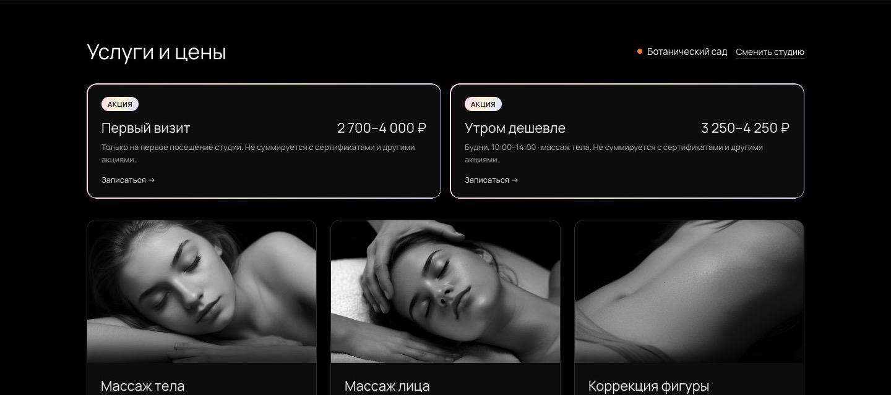
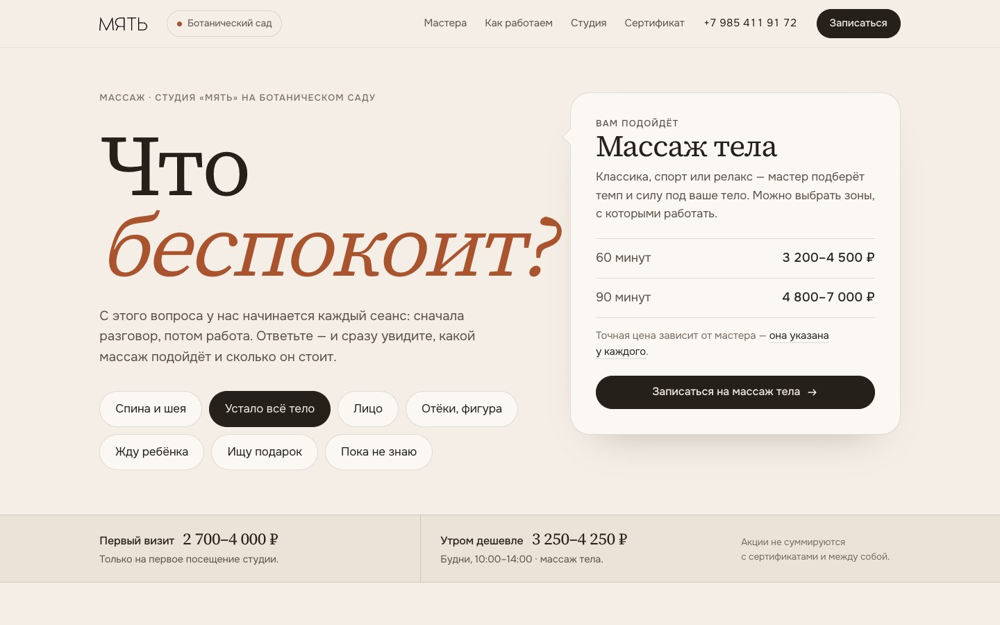
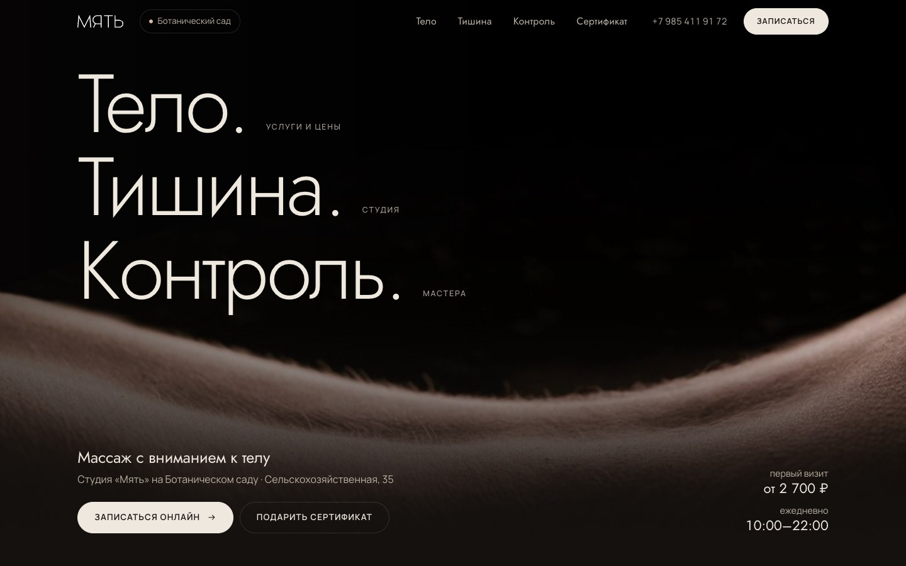
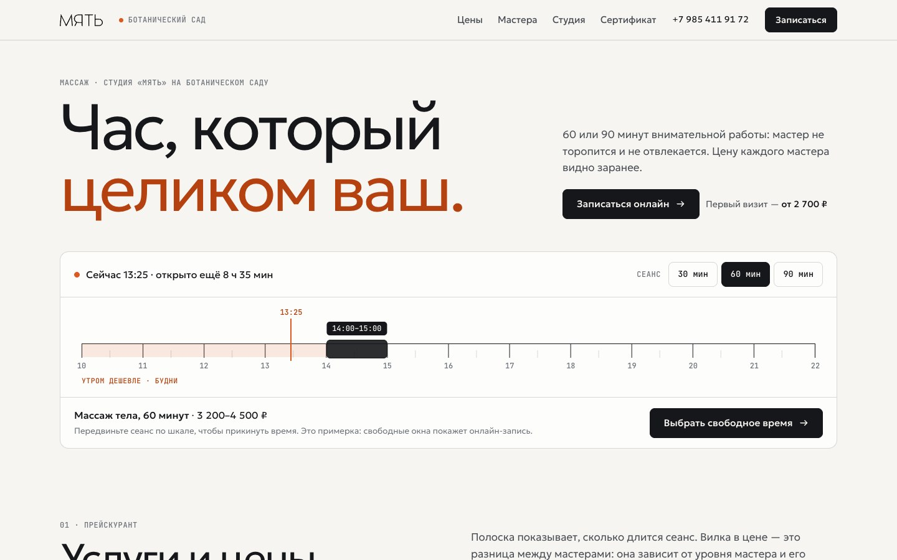

# «Мять», Ботанический сад — разбор и три концепта редизайна

Разбор страницы <https://myat.studio/?studio=botsad> по принципам Awwwards и три статических прототипа.
**Одна ссылка — прототип и объяснения на одном экране:**

<https://daniilglushko.github.io/myat-studio-concepts/>

Слева живой прототип (переключатель «десктоп / телефон»), справа объяснения; нажатие на пункт прокручивает прототип к нужному месту.

- Только прототип, без рамки: <https://daniilglushko.github.io/myat-studio-concepts/concepts/2-tri-slova.html>
- Разбор текущего сайта и другие концепты: <https://daniilglushko.github.io/myat-studio-concepts/razbor.html>

Страницы закрыты от поисковиков (`noindex`).

## Что не так сейчас

1. **Цена разорвана на две части.** В услугах вилки («3 200–4 500 ₽»), точные цены мастеров — двумя экранами ниже, причина вилки — в мелкой сноске.
2. **Первый экран почти пустой.** На телефоне верхняя половина — чёрное поле; слоган «Тело. Тишина. Контроль.» спрятан в подвале.
3. **Плоская типографика.** Один шрифт и одно начертание; на телефоне 72 из 78 текстовых блоков — 15 px и мельче, половина серым.
4. **Один ритм на всю страницу.** Семь одинаково устроенных секций на чистом чёрном, сетки 3 + 2 и 4 + 2 с пустыми хвостами.
5. **Фото не про эту студию.** Модельные лица вместо студии; картинки 1680 px в слоте 370 px; портреты мастеров сняты по-разному.
6. **Телефон: длинно и мелко.** 9 100 px (около 11 экранов), нет прилипающей кнопки записи, 41 ссылка и кнопка ниже 40 px.
7. **Не хватает сведений, чтобы дойти.** «Вход через барбершоп ANTIHERO» и «16 минут от метро» есть только на странице «Студии».
8. **Доверие названо, но не показано.** «112 отзывов» без единого отзыва на сайте.

Сохранить: скорость (≈1,7 МБ, около 2 с), тон текстов, точные цены мастеров, выбор студии, кадр первого экрана.

## Концепты

| | Идея | Кому подойдёт |
|---|---|---|
| [1 · Сначала разговор](concepts/1-razgovor.html) | Страница начинается с вопроса мастера «Что беспокоит?»; ответ сразу показывает массаж, длительность и цену. Мастера — с точной ценой каждого. | Новым клиентам, которые не знают, что выбрать. |
| [2 · Тело. Тишина. Контроль.](concepts/2-tri-slova.html) | Слоган становится каркасом: три слова — три главы и навигация. Тёмная, но тёплая. | Если важно сохранить нынешний образ бренда. |
| [3 · По минутам](concepts/3-minuty.html) | Шкала дня 10:00–22:00 с живым «сейчас» и окном «утром дешевле»; услуги — прейскурант, мастера — список с сортировкой. | Постоянным клиентам и тем, кто сравнивает цены. |

### 1 · Сначала разговор

### 2 · Тело. Тишина. Контроль.

### 3 · По минутам

Скриншоты целиком и мобильные — в `screenshots/concept-N/` (`desktop-top`, `desktop-full`, `mobile-top`, `mobile-full`).

## Концепт 2 — подробная версия (выбран)

Страница: [concepts/2-tri-slova.html](concepts/2-tri-slova.html). Объяснения: [explain-2.html](explain-2.html).

Что внутри: первый экран с тремя словами-главами → акции → **Тело** (услуги списком, под «Массажем тела» точная цена каждого мастера) →
**Тишина** (два фото студии, как дойти по шагам, вход через барбершоп ANTIHERO, 16 минут от метро, часы с пометкой «сейчас открыто») →
**Контроль** (правила сеанса, шесть мастеров с описанием, ценой и сортировкой, помеченное место под отзывы) → вопросы перед первым визитом →
сертификат → запись → подвал.

| Решение | Какую проблему закрывает | Принцип Awwwards |
|---|---|---|
| Слоган — каркас и навигация | №2 пустой первый экран, №4 один ритм | Сначала идея, потом технология |
| «Откуда вилка»: цена каждого мастера рядом с диапазоном | №1 цена разорвана | Удобство и содержание |
| Услуги списком, один кадр сбоку, на телефоне без фото | №5 фото не про студию, №4, №6 | Типографика — 90% дизайна; «убей любимчиков» |
| Jost 300 + Manrope, плавные размеры от 160 до 13,5 px | №3 плоская типографика | Два семейства, `clamp()`, трекинг |
| Тёплый тёмный #14110F, три уровня текста, один акцент | №4 сплошной #000 | Не чистый чёрный, проверенный контраст |
| У каждой главы своя раскладка | №4 одинаковые секции | Меняй ритм |
| «Как дойти» по шагам, «сейчас открыто» | №7 не хватает сведений | Дизайн под отрасль |
| Два настоящих фото студии шириной 230 px, WebP в репозитории | №5 | Без стока; скорость — это дизайн |
| Мастера: описание, цена, сортировка | №1, №8, №4 | Содержание и удобство |
| Помеченное место под отзывы | №8 (наполовину) | Содержание должно быть настоящим |
| Шесть ответов студии перед первым визитом | №8, частично №1 | Содержание |
| Главы в шапке, прилипающая кнопка, зоны нажатия от 44 px | №6 телефон | Телефон — не уменьшенный десктоп |
| Три движения, `prefers-reduced-motion` | риск декоративности | Движение должно рассказывать |
| 576 КБ на всё, ноль внешних запросов, клавиатура | сохраняет скорость | Скорость — это дизайн; доступность |

### Всё ли по Awwwards — честно

По ремеслу да, по зрелищности нет. Отступления:

- На телефоне страница **длиннее** нынешней: 11 760 px против 9 100 — в неё добавлены «как дойти», описания мастеров, вопросы, запись.
- Фото услуг остались прежними глянцевыми — заменить нечем; на телефоне они скрыты.
- Нет 3D, переходов страниц, сложной анимации — сознательно, но по критерию «креативность» это минус.
- Стили и скрипт в одном файле (условие «один файл на концепт»), текст 17 px вместо 18–20, цвета в hex, нет светлой темы.

Не доделано: отзывов нет; точная цена мастера известна только для массажа тела на 60 минут; запись на четыре услуги ведёт в общее меню;
фото студии два и оба с телефона; нет карты; не проверено на настоящем телефоне, в Safari и Lighthouse.

### Про «новые фото не прогрузились»

Подтвердилось первое прочтение: в прототипе фото тянулись ссылками с myat.studio, сервер отдаёт их за 1–2,5 с, одну — за 18 с.
Теперь 16 фото и логотип лежат в `assets/photos/` (410 КБ). На самом сайте все картинки загружаются (обновлены 5 и 8 ноября 2026);
если есть фото, ещё не выложенные на сайт, их нужно прислать.

## Рекомендация (до выбора)

Брать **концепт 1** и перенести в него из третьего сортировку мастеров и пометку «сейчас открыто».
Если принципиален тёмный образ — концепт 2.

Что нужно от студии: фотографии самой студии (сейчас есть только кадры с телефона 720×1280), два-три настоящих отзыва,
точные цены мастеров на 90 минут и остальные услуги, ссылки YCLIENTS на каждую услугу.

## Техническое

- Один HTML-файл на концепт, свои стили и скрипт внутри. Шрифты (OFL) лежат в `fonts/`, трекеров нет.
- В концепте 2 фото лежат в `assets/photos/` (обработанные копии, WebP). Концепты 1 и 3 подгружают логотип и фото с myat.studio — им нужен интернет.
- Кнопки записи ведут в настоящий YCLIENTS студии.
- Скриншоты: `node tools/shot.mjs <url> <префикс> <desktop|mobile>` (headless Chrome, без зависимостей).
